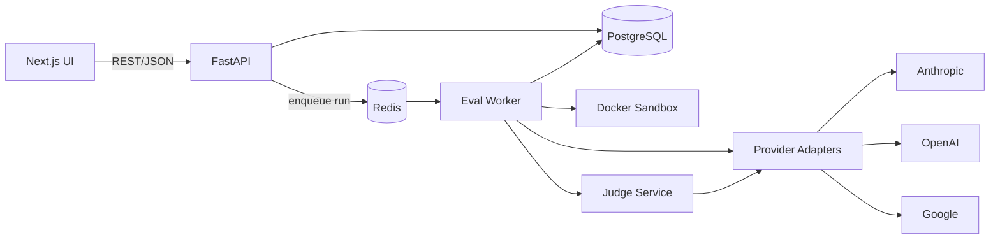

# SPEC.md — Frontier Model Evaluator (FME)

| Field | Value |
|---|---|
| Version | 0.1 (Draft) |
| Status | Awaiting spec approval (Gate G1) |
| Autonomy level | **Level 3: conditional autonomy** (see §9) |
| Owner | Madhu Kesarkar (QA Lead) |
| Method | Spec-driven development: Constitution → Spec → Plan → Tasks → Implement → Verify |

---

## 1. Goal

### 1.1 Problem
Teams building or testing AI-powered applications need to choose a frontier LLM. Vendor benchmarks are generic, token costs differ by provider, and model failure modes (hallucinations, broken JSON, wrong code) are rarely documented in one place. Teams pick models on reputation instead of evidence that matches their own use case.

### 1.2 Goal statement
Build a web application that:
1. **Evaluates** multiple frontier LLMs against a versioned task suite.
2. **Rates** each model **1–5 per category** (e.g., code generation, reasoning).
3. **Highlights token usage and cost** for every task across **Simple / Mid / Complex** tiers.
4. **Lists the bugs (defects)** found for each model, with evidence and severity.
5. Lets a user **click any model** to review its scores, token usage and defects, and **check whether it fits their application** under development or test.

### 1.3 Success metrics
| ID | Metric | Target |
|---|---|---|
| SM-1 | Full suite run for one model completes | ≤ 30 min |
| SM-2 | Score reproducibility: re-run variance per category | ≤ 0.5 points |
| SM-3 | LLM-judge agreement with human-labelled golden set (within ±1) | ≥ 80% |
| SM-4 | User reaches a fit verdict from the home page | ≤ 3 clicks |
| SM-5 | Every displayed defect links to its prompt, response and evidence | 100% |

### 1.4 Users
- **QA Lead / Test Architect**: wants to know where a model breaks before it is used in a product.
- **Engineering Manager / Tech Lead**: compares cost against quality to pick a model.
- **Developer**: checks which model handles their task type and complexity best.

### 1.5 Non-goals (v1)
- Not a public leaderboard or marketing benchmark.
- No fine-tuning, training or hosting of models.
- No multi-tenant SaaS, billing or user sign-up. Single team, single deployment.
- No image, audio or video evaluation. Text and code only.
- No real-time streaming evaluation. Batch runs only.

---

## 2. Glossary

| Term | Meaning |
|---|---|
| **Provider** | LLM vendor (e.g., Anthropic, OpenAI, Google) |
| **Model** | A specific, versioned model ID from a provider, defined in config |
| **Category** | Capability area that gets a 1–5 rating (see §3.2) |
| **Tier** | Task complexity: Simple, Mid or Complex (see §3.3) |
| **Task** | One versioned prompt, its fixtures, and its checking method |
| **Run** | One execution of the suite (or a subset) against one or more models |
| **Result** | One model's response to one task in one run, with tokens, cost, latency and score |
| **Defect** | A bug found in a model's output, classified by type and severity (see §3.5) |
| **Use-case profile** | The user's description of their app: category weights, must-haves, cost and latency limits |
| **Fit score / verdict** | Weighted score of a model against a profile, plus a Recommended / Conditional / Not recommended verdict |

---

## 3. Functional Requirements

### FR-01 Model registry
- Models are defined in `config/models.yaml`, not hard-coded.
- Each entry has: provider, model ID, display name, version or date, context window, input and output price per 1M tokens, and enabled flag.
- Adding a model requires a config change only, no code change.

```yaml
# config/models.yaml (example; fill in current model IDs and prices at setup time)
models:
  - key: anthropic-flagship
    provider: anthropic
    model_id: "<current-model-id>"
    display_name: "<Display Name>"
    context_window: 200000
    price_input_per_mtok: 0.00
    price_output_per_mtok: 0.00
    enabled: true
```

### FR-02 Task suite
- The suite covers **6 categories × 3 tiers**, with at least **5 tasks per cell** (90 or more tasks in v1).
- Each task is versioned. A content hash is stored so every result is tied to the exact prompt version used.
- Each task declares a checker type: `unit_tests`, `json_schema`, `exact_match`, `regex`, `llm_judge`, or a combination.

### FR-03 Evaluation runner
- A user can start a run by choosing models, categories, tiers and a repeat count (default n = 3).
- The runner uses fixed parameters per run (temperature, max tokens, seed where supported) and stores them with the run.
- Rate limits and transient errors are retried with exponential backoff (max 3 retries). Timeouts are recorded as defects, not hidden.
- Generated code is executed **only in a sandboxed container** with no network access and CPU, memory and time limits.
- Each run has a **budget cap in USD**. The run stops cleanly when the cap is reached and is marked `stopped_budget`.

### FR-04 Scoring (1–5 per category)
- Each result is scored 1–5 by combining automated checks with an LLM judge that follows the rubric below.
- **A model is never judged by itself.** Two judges from different providers score each result. If they disagree by more than 1 point, the result is flagged for human review.
- Category score = mean of task scores across tiers, shown to 1 decimal. Per-tier scores are also shown.

| Score | Label | Rubric |
|---|---|---|
| 5 | Excellent | Fully correct, meets every constraint, no defects |
| 4 | Good | Correct; at most cosmetic (S4) issues |
| 3 | Acceptable | Mostly correct; one S3 defect or needs light edits |
| 2 | Poor | Partially correct; an S2 defect or significant rework needed |
| 1 | Fail | Wrong, unsafe, wrongly refused, an S1 defect, or no usable output |

### FR-05 Token and cost tracking
- For every result, store: input tokens, output tokens, reasoning/thinking tokens (if reported), cached tokens (if reported), cost in USD, and latency in ms.
- Provider-reported counts are the source of truth. If a provider doesn't report a value, it is estimated and labelled **"estimated"** in the UI.
- Aggregate per model × tier: average and total tokens, average cost per task, and p50/p95 latency.
- The UI must note that **tokenizers differ by provider**, so raw token counts are not directly comparable. Cost per task is the comparable measure.

### FR-06 Defect detection and logging
- Defects are created automatically (from failed checks), by an LLM judge, or manually by a reviewer.
- Each defect records: model, task, tier, category, type, severity, title, expected vs actual, evidence (prompt and response excerpt), source (`auto`, `judge`, `human`), and status (`open`, `confirmed`, `false_positive`).

**Defect taxonomy**

| Type | Example |
|---|---|
| `HALLUCINATION` | Invents an API, fact or citation |
| `INSTRUCTION_VIOLATION` | Ignores an explicit constraint (length, language, "don't use X") |
| `FORMAT_BREAK` | Invalid JSON or schema mismatch |
| `INCORRECT_CODE` | Code fails the provided unit tests or doesn't compile |
| `REASONING_ERROR` | Wrong logic or arithmetic in the final answer |
| `TOOL_CALL_ERROR` | Wrong tool, wrong arguments, or an invalid tool-call format |
| `OVER_REFUSAL` | Refuses a benign request |
| `UNSAFE_OUTPUT` | Produces harmful or insecure content (e.g., hard-coded secrets, SQL injection) |
| `TRUNCATION` | Incomplete output that hits the max-token limit |
| `TIMEOUT_ERROR` | No response, provider error, or timeout after retries |
| `INCONSISTENCY` | Same task gives materially different answers across repeats |

**Severity levels**

| Severity | Meaning |
|---|---|
| S1 Critical | Unsafe, or silently wrong in a way that would ship a bug |
| S2 Major | Wrong or unusable, but detectable |
| S3 Minor | Usable with edits |
| S4 Cosmetic | Style or verbosity only |

### FR-07 Leaderboard (home page)
- A table of models with columns: overall score, a 1–5 score per category, average cost per task, p50 latency, and open S1/S2 defect count.
- Sortable by any column. Filterable by tier and category.
- Each model row is clickable and opens the model detail page.

### FR-08 Model detail page
- Header showing model name, provider, version, last run date and overall score.
- **Category scores**: 1–5 per category, with a Simple/Mid/Complex breakdown (chart and table).
- **Token usage panel**: tokens and cost per tier, with the costliest tasks highlighted.
- **Defects list**: filterable by type, severity, category and tier. Each defect expands to show its evidence.
- **Task drill-down**: each task's prompt, response, checks, judge rationale, tokens and cost.

### FR-09 Model comparison
- A user can select 2–4 models and view them side by side: category scores, cost per tier, and defect counts by type.

### FR-10 Use-case fit
- A user creates a **use-case profile** with:
  - category weights (0–5 each),
  - must-have categories,
  - expected tier mix (e.g., 20% simple / 60% mid / 20% complex),
  - max cost per task (optional),
  - max p95 latency (optional).
- The system calculates a **fit score** for each model and assigns a **verdict**:
  - **Recommended**: fit ≥ 4.0 and no blockers.
  - **Conditional**: fit 3.0–3.99, or a soft limit is exceeded. Each reason is listed.
  - **Not recommended**: fit < 3.0, **or** any confirmed S1 defect in a must-have category, **or** a must-have category scores below 3.0.
- Every verdict shows **why**: top strengths, top risks, and the defects that drove the verdict.
- Profiles are saved and reusable. Templates are provided (e.g., "Test-case generation tool", "Customer support chatbot", "Code assistant").

### FR-11 Export
- Leaderboard, model detail and defect list can be exported as CSV and JSON.

### FR-12 Run history and reproducibility
- Every run stores suite version, task hashes, model versions, parameters, judge models, and spend.
- A user can view past runs and see how a model's scores changed between two runs.

---

## 3.2 Categories (v1)
1. **Code Generation**: write or fix functions, checked by unit tests.
2. **Reasoning & Analysis**: multi-step logic and math word problems.
3. **Instruction Following & Structured Output**: strict formats and JSON schemas.
4. **Test Design (QA)**: generate test cases and edge cases from a requirement; scored for coverage against a reference list.
5. **Long-Context & Retrieval Faithfulness**: answer from a provided document without hallucinating.
6. **Tool Use / Agentic**: choose and call mock tools correctly over several steps.

## 3.3 Tier definitions
| Tier | Definition | Typical prompt size |
|---|---|---|
| Simple | Single step, one clear instruction, short answer | < 500 tokens |
| Mid | 2–5 steps, several constraints, moderate context | 500–3,000 tokens |
| Complex | Multi-file or long-context work, ambiguity, or multi-turn tool use | > 3,000 tokens |

---

## 4. Acceptance Criteria

Format: **Given / When / Then**. Each AC traces to an FR and must have at least one automated test.

### Model registry (FR-01)
- **AC-01** Given a valid new entry in `models.yaml`, when the app starts, then the model appears in the registry and can be selected for a run, with no code change.
- **AC-02** Given an entry missing `model_id` or prices, when the app starts, then startup fails with a validation error naming the field and the entry.
- **AC-03** Given a model with `enabled: false`, when a user starts a run, then that model cannot be selected.

### Task suite and runner (FR-02, FR-03)
- **AC-04** Given the v1 suite, when it is validated, then every category × tier cell has at least 5 tasks and every task has a checker and a hash.
- **AC-05** Given a run with 2 models and n = 3, when it completes, then there are exactly 2 × tasks × 3 results, each with status `scored`, `error`, or `skipped`.
- **AC-06** Given a provider returns HTTP 429, when the runner calls it, then it retries with backoff up to 3 times before recording a `TIMEOUT_ERROR` defect.
- **AC-07** Given a $5 budget cap, when cumulative spend reaches $5, then no new calls start, in-flight calls finish, and the run status is `stopped_budget`.
- **AC-08** Given generated code that tries a network call, when executed in the sandbox, then the call is blocked and the run continues.
- **AC-09** Given generated code that runs past the sandbox time limit, when executed, then it is killed and the result is scored with an `INCORRECT_CODE` or `TIMEOUT_ERROR` defect.

### Scoring (FR-04)
- **AC-10** Given any result, when it is scored, then the score is an integer from 1 to 5 and a rationale is stored.
- **AC-11** Given a result from model X, when judges are assigned, then neither judge is model X.
- **AC-12** Given two judge scores that differ by more than 1, when scoring completes, then the result is flagged `needs_review` and is visible in a review queue.
- **AC-13** Given a code task whose unit tests all fail, when scored, then the score is ≤ 2, whatever the judge says.
- **AC-14** Given the human-labelled golden set, when the judge calibration test runs, then agreement within ±1 is ≥ 80% (SM-3).

### Tokens and cost (FR-05)
- **AC-15** Given a completed result, when stored, then input tokens, output tokens, cost and latency are all present and non-negative.
- **AC-16** Given known token counts and prices, when cost is calculated, then it equals `(in × price_in + out × price_out) / 1,000,000`, accurate to $0.000001.
- **AC-17** Given a provider that doesn't report reasoning tokens, when shown in the UI, then the value shows "n/a" or "estimated", never 0.
- **AC-18** Given a model detail page, when the token panel loads, then averages and totals are shown separately for Simple, Mid and Complex.

### Defects (FR-06)
- **AC-19** Given a response that fails JSON schema validation, when checked, then a `FORMAT_BREAK` defect is created automatically with the validation error as evidence.
- **AC-20** Given any defect, when opened, then it shows the prompt, the response excerpt, expected vs actual, severity and source.
- **AC-21** Given a reviewer marks a defect `false_positive`, when scores are recalculated, then that defect no longer counts toward verdicts or defect counts.

### Leaderboard, detail and comparison (FR-07, FR-08, FR-09)
- **AC-22** Given a completed run, when the user opens the home page, then every enabled, evaluated model is listed with a 1–5 score for each category.
- **AC-23** Given the leaderboard, when the user clicks a model row, then the model detail page opens within 2 seconds (p95, seeded DB).
- **AC-24** Given the defects list, when filtered by severity S1 and tier Complex, then only matching defects are shown and the count updates.
- **AC-25** Given 3 selected models, when the user opens Compare, then category scores, cost per tier and defect counts are shown side by side.

### Use-case fit (FR-10)
- **AC-26** Given a profile with "Code Generation" as must-have, and a model with a confirmed S1 defect in that category, when fit is calculated, then the verdict is **Not recommended** and the defect is cited as the reason.
- **AC-27** Given a profile with max cost per task of $0.01, and a model averaging $0.03 under that profile's tier mix, when fit is calculated, then the verdict is at best **Conditional** and the cost overrun is shown.
- **AC-28** Given the same profile and the same run data, when fit is calculated twice, then the results are identical (deterministic).
- **AC-29** Given a new user on the home page, when they choose a profile template, then they see a verdict for every model within 3 clicks (SM-4).

### Export and history (FR-11, FR-12)
- **AC-30** Given a leaderboard view, when exported to CSV, then the rows and values match the UI exactly.
- **AC-31** Given two runs of the same model, when compared, then score changes per category are shown with the suite version of each run.

### Non-functional
- **AC-32** Given any log, API response or frontend bundle, when scanned, then no provider API key appears (secret-scan test in CI).
- **AC-33** Given every main page, when checked with axe-core, then there are no serious or critical WCAG 2.1 AA violations.

---

## 5. Non-Functional Requirements
| Area | Requirement |
|---|---|
| Security | API keys only in env vars / secret store; never logged or sent to the browser. The sandbox has no network and runs as a non-root user. |
| Cost control | Per-run budget cap (FR-03). CI never calls live providers except in the nightly job, which has its own cap. |
| Reproducibility | Pinned model versions, stored parameters, task hashes, seeded runs where the provider supports it. |
| Performance | API p95 < 500 ms for read endpoints on a seeded DB. UI page load < 2 s. |
| Reliability | Runs can be resumed after a crash. Results are written per task, not only at the end. |
| Accessibility | WCAG 2.1 AA. |
| Observability | Structured JSON logs with run ID and task ID. Run progress shown in the UI. |
| Transparency | Every score and verdict can be traced to raw evidence in ≤ 2 clicks. |

---

## 6. Technology Stack

| Layer | Choice | Reason |
|---|---|---|
| Eval engine and API | **Python 3.12, FastAPI, Pydantic v2** | Strong LLM SDK ecosystem; typed request/response models |
| LLM access | **Provider adapter interface** using official SDKs (Anthropic, OpenAI, Google GenAI). LiteLLM is an optional alternative. | One interface; provider-reported token usage captured accurately |
| Background jobs | **arq + Redis** | Async workers for long runs; resumable |
| Database | **PostgreSQL 16** (SQLite allowed for local dev), **SQLAlchemy 2 + Alembic** | Relational data, migrations |
| Code sandbox | **Docker** container (no network, CPU/mem/time limits, non-root) | Safe execution of generated code |
| Frontend | **Next.js (App Router) + TypeScript, Tailwind CSS, shadcn/ui, Recharts, TanStack Query** | Fast, typed, accessible components and charts |
| Unit/integration tests | **pytest, pytest-asyncio, respx** with recorded provider fixtures; **Vitest** for frontend | No live API calls in normal CI |
| Contract tests | **Pact** (pact-js consumer in frontend, pact-python provider verification) | UI ↔ API contract safety |
| E2E and accessibility | **Playwright + @axe-core/playwright** | User journeys and AC-33 |
| Code quality | ruff, mypy (strict), ESLint, Prettier, pre-commit, gitleaks | Lint, types, secret scanning |
| CI/CD | **GitHub Actions**, Docker Compose | PR checks plus a nightly live-eval job with a budget cap |

---

## 7. Architecture



### 7.1 Data model
| Table | Key fields |
|---|---|
| `model` | id, provider, model_id, display_name, version, context_window, price_in, price_out, enabled |
| `task` | id, category, tier, title, prompt_template, fixtures, expected, checker_types, rubric, version, content_hash |
| `run` | id, status, suite_version, params_json, model_ids, judge_model_ids, budget_usd, spent_usd, started_at, finished_at |
| `result` | id, run_id, model_id, task_id, attempt, response, input_tokens, output_tokens, reasoning_tokens, cached_tokens, tokens_estimated, cost_usd, latency_ms, checks_json, judge_scores_json, score, rationale, status, needs_review |
| `defect` | id, result_id, model_id, task_id, category, tier, type, severity, title, expected, actual, evidence, source, status |
| `profile` | id, name, weights_json, must_have, tier_mix_json, max_cost_per_task, max_p95_latency_ms |

### 7.2 API (v1)
| Method | Path | Purpose |
|---|---|---|
| GET | `/api/models` | List models |
| GET | `/api/leaderboard?run_id=&tier=&category=` | Leaderboard data |
| GET | `/api/models/{id}?run_id=` | Model detail: scores, tokens, summary |
| GET | `/api/models/{id}/defects?severity=&type=&tier=&category=` | Defects for a model |
| GET | `/api/models/{id}/results?task_id=` | Task drill-down |
| GET | `/api/compare?model_ids=&run_id=` | Side-by-side comparison |
| POST | `/api/runs` | Start a run (models, categories, tiers, repeats, budget) |
| GET | `/api/runs/{id}` | Run status and progress |
| PATCH | `/api/defects/{id}` | Reviewer updates status or severity |
| POST | `/api/fit` | Fit scores and verdicts for a profile |
| CRUD | `/api/profiles` | Manage use-case profiles |
| GET | `/api/export?view=&format=csv\|json` | Export |

The OpenAPI schema generated by FastAPI is the contract source. Pact tests verify that the frontend's use of it matches.

### 7.3 Repository layout
```
/
├── SPEC.md                  ← this file (source of truth)
├── specs/
│   ├── constitution.md      ← non-negotiable project rules
│   ├── plan.md              ← technical plan (Gate G2)
│   └── tasks.md             ← ordered task list with AC links
├── AGENTS.md / CLAUDE.md    ← agent operating rules (§9)
├── config/models.yaml
├── suite/                   ← tasks by category/tier + golden set
├── backend/                 ← FastAPI, worker, adapters, scoring
├── frontend/                ← Next.js app
├── sandbox/                 ← Dockerfile for code execution
├── tests/                   ← unit, integration, contract, e2e
└── .github/workflows/
```

---

## 8. Test Strategy
| Level | Scope | Tooling |
|---|---|---|
| Unit | Scoring math, cost formula, fit verdict rules, defect classifiers | pytest, Vitest |
| Integration | Runner + adapters using **recorded** provider responses | pytest + respx fixtures |
| Contract | UI ↔ API | Pact |
| Sandbox | Network blocked, time and memory limits enforced | pytest + Docker |
| Judge calibration | Agreement with the human golden set (AC-14) | pytest, nightly |
| E2E | Leaderboard → model → defects → fit journey | Playwright |
| Accessibility | Main pages | axe-core |
| Security | Secret scanning, dependency audit | gitleaks, pip-audit, npm audit |
| Live smoke (nightly) | 1 task per category × tier per model, with a budget cap | GitHub Actions |

**Traceability rule:** every AC-xx has at least one test whose name contains its ID (e.g., `test_AC16_cost_formula`). CI fails if any AC has no test.

---

## 9. Level 3 Autonomy Setup

### 9.1 Definition
**Level 3 (conditional autonomy):** the AI agent plans and carries out tasks from `tasks.md` end to end. It writes code and tests, runs them, fixes failures and opens PRs without step-by-step instructions. **Humans approve at defined gates** and on any action listed in §9.3. The agent does not change *what* is being built. Only the spec owner changes the spec.

### 9.2 The agent MAY, without asking
- Pick the next unblocked task from `tasks.md` and work on a feature branch (`feat/T-xx-short-name`).
- Create and edit files inside the repo, except `SPEC.md`, `specs/constitution.md` and the CI workflow files.
- Install dependencies from the approved stack in §6, at pinned versions.
- Run linters, type checks, unit/integration/contract/E2E tests, and Docker Compose locally.
- Fix its own failing tests and lint errors. It may make **up to 3 fix attempts per failure** before escalating.
- Use **recorded fixtures only** for provider calls.
- Open a PR with a filled-in template, and tick tasks off in `tasks.md`.

### 9.3 The agent MUST STOP and ask for approval before
- Changing `SPEC.md`, any acceptance criterion, or `constitution.md`. It proposes the change in the PR description instead.
- Adding a dependency that isn't in §6, or changing a major version.
- Making **any live LLM API call**, or any call that spends money.
- Running destructive DB migrations (drop or rename a column or table).
- Touching secrets, `.env` files, CI workflows or deployment config.
- Merging to `main`, force-pushing, or deleting branches.
- Deleting or skipping a test, or weakening an assertion, to make CI pass.
- Proceeding when a requirement is ambiguous. It marks the item `[NEEDS CLARIFICATION]` and asks.

### 9.4 Human gates
| Gate | When | Who approves | Output |
|---|---|---|---|
| **G1 Spec** | Before any code | Spec owner | Approved `SPEC.md` v1.0 |
| **G2 Plan** | After `plan.md` and `tasks.md` are drafted | Spec owner + tech reviewer | Approved plan and task list |
| **G3 Milestone PR** | End of each milestone (§10) | Reviewer | Merged PR, demo of the milestone's ACs |
| **G4 Live run** | Before the first live eval | Spec owner | Budget cap and model list confirmed |
| **G5 Release** | After M7 | Spec owner | All ACs green; v1 tag |

### 9.5 Definition of Done (per task)
- Code is written and every linked AC has a passing test with the AC ID in its name.
- ruff, mypy, ESLint and all test suites pass locally and in CI.
- No new secrets, `TODO`s without a task ID, or skipped tests.
- `tasks.md` is updated. The PR description lists the ACs covered and any assumptions made.

### 9.6 Escalation format
When the agent stops, it posts:
```
BLOCKED: T-xx <title>
Reason: <rule from §9.3, or what is ambiguous>
What I tried: <bullets>
Options: A) ...  B) ...  (recommended: A, because ...)
Needed from you: <decision / approval / info>
```

### 9.7 Guardrails
- Budget: live-run cap per run (default $5) and per day (default $20), enforced in code (AC-07).
- Command allowlist for the agent: `git` (no push to main), `pytest`, `npm`/`pnpm` scripts, `ruff`, `mypy`, `docker compose`, `alembic upgrade` (non-destructive).
- Branch protection on `main`: PR plus green CI plus 1 human approval required.

---

## 10. Milestones and Tasks (initial; refined at G2)

| Milestone | Tasks | Covers |
|---|---|---|
| **M0 Scaffold** | T-01 Repo, tooling, pre-commit, CI skeleton · T-02 Docker Compose (API, DB, Redis, UI) · T-03 AC traceability check in CI | NFR |
| **M1 Registry & adapters** | T-04 `models.yaml` loader + validation · T-05 Adapter interface + 3 providers with token capture · T-06 Recorded fixtures | AC-01–03, AC-15, AC-17 |
| **M2 Suite & runner** | T-07 Task schema + hashing · T-08 Seed 90 tasks + golden set · T-09 arq worker, retries, resume · T-10 Budget cap · T-11 Docker sandbox | AC-04–09 |
| **M3 Scoring & defects** | T-12 Automated checkers · T-13 Dual judge + rubric + no self-judging · T-14 Defect classifier + taxonomy · T-15 Review queue + false-positive handling · T-16 Judge calibration test | AC-10–14, AC-19–21 |
| **M4 Tokens & cost** | T-17 Cost calculator · T-18 Per-tier aggregates, p50/p95 | AC-16, AC-18 |
| **M5 UI** | T-19 Leaderboard · T-20 Model detail (scores, tokens, defects, drill-down) · T-21 Compare · T-22 Pact contracts | AC-22–25 |
| **M6 Use-case fit** | T-23 Profiles + templates · T-24 Fit engine + verdict rules · T-25 Fit UI with reasons | AC-26–29 |
| **M7 Hardening** | T-26 Export · T-27 Run history and diff · T-28 Accessibility + secret-scan · T-29 Nightly live smoke job | AC-30–33 |

---

## 11. Open Questions
- `[NEEDS CLARIFICATION]` Which exact models and versions go into the first run, and what is the total budget for v1 evaluation?
- `[NEEDS CLARIFICATION]` Are the 6 categories in §3.2 right for your target users, or should a category be swapped (e.g., "API test generation" or "Bug report triage")?
- `[NEEDS CLARIFICATION]` Who labels the human golden set, and how many items (suggested: 60, 10 per category)?
- `[NEEDS CLARIFICATION]` Is the app internal only, or does it need login (SSO) in v1?
- `[NEEDS CLARIFICATION]` Should users be able to upload their **own** tasks (from their app under test) and have them evaluated? This is a strong v2 candidate.
